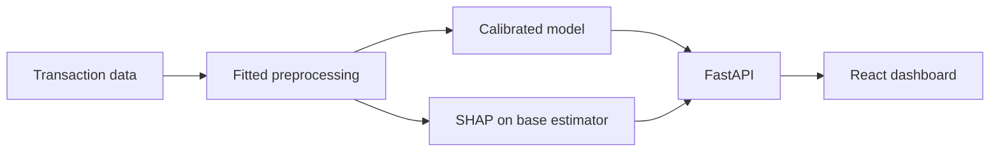

# FraudShield AI

**Transaction risk scoring, fraud analytics, and model explanations in one dashboard.**

FraudShield combines a React interface with a Python machine learning API. Explore transaction patterns, investigate flagged records, and score new transactions with an explanation of what influenced the model.


## Features

- **Fraud analytics** — explore patterns across dates, merchants, payment methods, and locations.
- **Transaction investigation** — search and filter records, compare risk scores, and inspect known outcomes.
- **Risk prediction** — score individual transactions or JSON batches through the dashboard or API.
- **Model explanations** — inspect SHAP feature contributions for individual predictions.
- **Model evaluation** — review precision–recall curves, a confusion matrix, and threshold analysis.
- **Data monitoring** — check validation reports and compare training and test distributions.

## Tech stack

| Layer | Technologies |
|---|---|
| Dashboard | React, TypeScript, Vite, Recharts |
| API | FastAPI, Pydantic, Uvicorn |
| Machine learning | scikit-learn, SHAP |
| Data analysis | pandas, NumPy, SciPy, Matplotlib |

## Run locally

Requires **Python 3.12+** and **Node.js 22+**. These commands use PowerShell.

### 1. Set up Python and train the model

```powershell
git clone https://github.com/HarshBajania/FraudShield-AI.git
cd FraudShield-AI

python -m venv .venv
.\.venv\Scripts\Activate.ps1
python -m pip install -r requirements-lock.txt
python -m scripts.train
```

The trained model is generated locally and excluded from Git. Train once on the first run; reuse the saved model afterward.

### 2. Start the API

In the same terminal:

```powershell
python -m uvicorn api.main:app --host 127.0.0.1 --port 8000
```

### 3. Start the dashboard

Open a second terminal in the project folder:

```powershell
cd frontend
npm ci
npm run dev -- --port 5174 --strictPort
```

- Dashboard: [localhost:5174](http://localhost:5174)
- Interactive API docs: [localhost:8000/docs](http://localhost:8000/docs)

Keep both terminals running. Configuration options are listed in [.env.example](.env.example); export them in your shell when needed.

## Model results

The selected model is a **weighted random forest with probability calibration**. It was evaluated on **745 chronologically held-out transactions**, after training, tuning, calibration, and threshold selection.

| Metric | Test result |
|---|---:|
| Average precision | 0.305 |
| ROC-AUC | 0.838 |
| Precision | 27.8% |
| Recall | 55.6% |

At the selected threshold, the model detected **35 of 63 fraud cases** and flagged **91 legitimate transactions**. Full results and experiment settings are saved in [model metadata](models/metadata.json).

## How it works



The main dataset contains **5,000 transactions**. Training uses separate chronological windows for fitting, tuning, calibration, threshold selection, and testing. The API reuses the fitted pipeline for inference. SHAP explains the base estimator before calibration. A second dataset is evaluated independently rather than merged with the main source.

## Checks

With the Python environment active and the model trained:

```powershell
python -m pytest -q
```

With the API running:

```powershell
python -m scripts.smoke
```

The tests cover input validation, preprocessing, chronological splits, prediction consistency, API behavior, and SHAP additivity.

## Documentation

- [Modeling approach and evaluation](docs/methodology.md)
- [API endpoints and examples](docs/api.md)
- [Dataset schemas and source limitations](data/README.md)
- [Validation report](docs/validation.md)
- [Demo walkthrough](docs/demo-guide.md)

## Scope

FraudShield is a research project built around static datasets. Dataset provenance, currency, and timezone are undocumented; displayed amounts use dataset units. Monitoring compares offline data distributions rather than live traffic.
