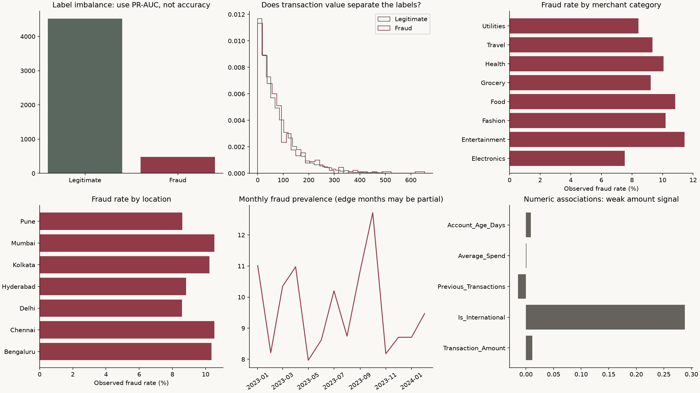
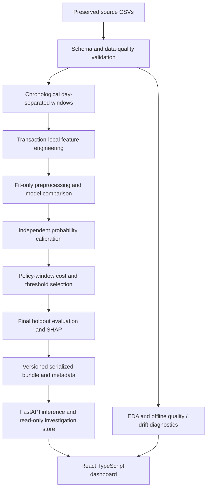

# FraudShield AI — Financial Fraud Detection & Risk Analytics

FraudShield is a reproducible fraud investigation application with chronological ML evaluation, calibrated risk scoring, real SHAP explanations, a FastAPI service and a React/TypeScript dashboard. It turns the existing descriptive notebook and supplied datasets into a system an analyst can inspect, with a business objective based on review cost and missed fraud value.

The business question is how to prioritize a limited review queue while balancing missed fraud value against investigation cost and false-positive friction. This is an **offline portfolio research application**, with measured holdout results and explicit source limitations. It does not claim bank-grade identity, real-time processing or production performance.




## Data and preserved work

The two original CSVs and original notebook are retained. The notebook's input paths are made portable, and new notebooks reference shared production code and experiment outputs.

| Source | Records | Labeled fraud | Role |
|---|---:|---:|---|
| Financial transactions | 5,000 | 482 (9.64%) | Main platform |
| Credit-card transactions | 100,000 | 1,000 (1%) | Independent benchmark |

The schemas differ and are not pooled. No provenance, license, currency, timezone or label-generation process was supplied. Values are shown as dataset units. See [data contracts](data/README.md) and [actual audit](docs/reports/audit.json). The financial file has two zero amounts and 240 IQR upper outliers; these are reported and retained. Both files have no missing values or duplicate rows.

The initial analysis shows weak amount/label correlation. Location and merchant plots report rates, not merely transaction counts. Temporal plots distinguish partial edge months. The credit benchmark selected histogram gradient boosting on validation, but its holdout PR-AUC is **0.0089**, below **0.0102** prevalence, and ROC-AUC **0.4588**. This tested protocol provides no useful fraud-ranking evidence for that dataset. The platform does not hide this result or present the two sources as one model.

## Modeling methodology

Five chronological windows separated at whole-day boundaries:

| Window | Rows | Fraud | Purpose |
|---|---:|---:|---|
| Fit | 2,457 | 237 | Fit preprocessing and estimators |
| Tune | 764 | 73 | Select hyperparameters by average precision |
| Calibration | 535 | 62 | Fit sigmoid probability calibration |
| Policy | 499 | 47 | Optimize review threshold and select model by cost |
| Test | 745 | 63 | Evaluate selected model once |

Median imputation, scaling and one-hot encoders are fitted only on fit data, inside each estimator pipeline. The serialized bundle contains the fitted preprocessing, estimator and calibration transform used by the API. No API-specific preprocessing is manually duplicated.

Evaluate unweighted/weighted logistic regression, unweighted/weighted random forest and gradient boosting. This compares a linear baseline, nonlinear interactions and additive tree structure while testing class weighting explicitly. SMOTE is not justified for these mixed-category source records; no resampling happens before splitting. Class weighting, sigmoid calibration and optimized thresholds address different parts of the imbalance problem. See [full methodology](docs/methodology.md) for model grids, selection, limitations and metric definitions.

Eligible inputs are transaction amount, international status, account age, merchant category, payment method, device type and location. Engineered features are log1p(amount), cyclical hour sine/cosine, weekday and weekend indicator. All can be computed from the current transaction. IDs and labels are excluded. `Suspicious_Keyword`, `Previous_Transactions` and `Average_Spend` are excluded because point-in-time provenance is unknown; a strong association is not sufficient justification to serve a feature. No synthetic histories, velocities or customer profiles are invented.

## Actual final holdout results

The **weighted random forest** was selected for the lowest calibrated policy-window scenario cost under a 20% review-capacity constraint. These are the actual local run's test results; `models/metadata.json` is the authoritative record. Dependency versions and dataset fingerprint are saved with every training run. Container retraining may produce different measured results.

| Metric | Result |
|---|---:|
| Average precision (PR-AUC) | 0.3050 |
| ROC-AUC | 0.8381 |
| Precision | 27.78% |
| Recall / fraud capture rate | 55.56% |
| F1 | 0.3704 |
| Brier score | 0.0677 |
| False positive rate | 13.34% |
| False negative rate | 44.44% |
| Precision@149 | 28.19% |
| Recall@149 | 66.67% |
| Fraud amount capture rate | 60.71% |
| Review rate | 16.91% |
| Review threshold | 0.2408814486 |

Confusion matrix (actual rows, predicted columns): `[[591, 91], [28, 35]]`. The model misses 28 of 63 fraud records and raises 91 false positives; these are material limitations.

Captured labeled fraud amount: **3,354.25** units. Missed amount: **2,171.03**. Legitimate value flagged: **7,792.42**. Investigation cost: **630.00**. Total scenario cost: **2,983.03**, compared with **5,525.28** for the independently selected no-signal baseline's no-review policy. These are estimates under assumed costs, not measured savings or prevented losses.

PR-AUC is average precision, not trapezoidal integration. The dashboard displays the actual seeded bootstrap interval, calibration error, comparison tables, confusion matrix and holdout curves. The primary family was selected without test-set threshold optimization. Model comparison shows tuning and policy outcomes; it does not evaluate every candidate on test and pick the best after the fact.

## Threshold, risk and explanations

The policy cost is `flags × review_cost + false_positives × friction_cost + missed_fraud_amount × loss_multiplier`. The checked-in scenario uses 5 review units, 2 friction units and full missed transaction value, with a 20% policy-window review-capacity limit. These are configurable assumptions in `configs/training.json`. The threshold search includes a grid, all policy score cutoffs and a no-review option. Retrain after changing the scenario; the held-out test must not become a tuning set.

Risk score = calibrated probability × 100. Default display bands are Low <25, Moderate <50, High <75, Critical ≥75. They are configurable UI conventions rather than financial standards. A score can be in the Low band yet exceed the optimized review threshold; the dashboard separates the band from the decision.

TreeSHAP explains the selected forest's **uncalibrated probability**. Contributions plus baseline reconstruct the actual estimator output; sigmoid calibration maps that to the displayed probability. Local explanations show the top transformed terms, and global importance uses up to 200 held-out records. Contributions are model associations, not causal evidence. Integration tests verify additivity and that single/batch inference agree.

## Architecture



```text
FraudShield-AI/
  data/raw/                 Original CSVs, unchanged
  notebooks/                Original EDA plus reproducible analysis workflows
  src/                      Validation, features, evaluation, model, SHAP, monitoring
  api/                      Typed contracts, service, routes, operational logging
  frontend/                 React, TypeScript, Recharts, responsive charcoal UI
  configs/training.json     Experiment seed, chronological fractions, cost scenario
  scripts/                  Audit, training and verification entrypoints
  models/                   Local trusted bundle, metadata, held-out IDs, reference
  tests/                    Behavioral unit and real-model API integration tests
  docs/                     Methodology, API, run report and analytical artifacts
  requirements-lock.txt     Exact dependencies used for local validation
  Dockerfile
  docker-compose.yml
```

## Dashboard and API

The charcoal/warm-white interface uses burgundy for risk and amber for warnings, with responsive desktop/tablet navigation and no simulated metrics. Executive overview reports counts, rates, value, probability-weighted exposure, recent known fraud and model evidence. Fraud analytics covers time, merchant, payment, location, amount bands, probability distribution, high-risk counts and observed fraud value. Investigation supports ID search, location/category/risk/decision/amount filters, sort direction, pagination and an explanation drawer. Prediction supports single form inputs and JSON batches. Model evidence exposes curves, confusion matrix, threshold economics, scenario costs and SHAP importance. Monitoring shows data-quality checks, numerical/categorical drift, lineage and source limitations.

Test cohort is the default. Development/all cohorts warn that records may have been seen during fitting or selection. Known labels and model decisions are distinct. Forms validate bounds, empty states explain absent results, and API failures are shown with retry/connection controls. Predictions are not silently persisted or counted as new real transactions.

Endpoints: `GET /health`, `/model/info`, `/model/metrics`, `/transactions`, `/transactions/{id}`, `/analytics/overview`, `/analytics/fraud`, `/model/explain/{id}`, `/monitoring`; `POST /predict`, `/predict/batch`. Full schemas, examples and query contracts: [API documentation](docs/api.md) or running OpenAPI at `http://localhost:8000/docs`.

## Install and run locally

Use Python 3.12+ and Node 22+. From the project root:

```powershell
python -m venv .venv
.\.venv\Scripts\Activate.ps1
python -m pip install -r requirements-lock.txt
python -m scripts.audit
python -m scripts.train
python -m pytest -q
python -m uvicorn api.main:app --host 127.0.0.1 --port 8000 --no-access-log
```

In another terminal:

```powershell
cd frontend
npm ci
npm run build
npm run dev
```

Open `http://localhost:5173`. Vite proxies `/api` to port 8000. The current restricted workspace used project-local `.vendor` packages because its normal venv bootstrap failed; to run the already validated environment:

```powershell
$env:PYTHONPATH='.vendor'
$env:MPLCONFIGDIR='docs/reports/.mplcache'
python -m uvicorn api.main:app --host 127.0.0.1 --port 8000 --no-access-log
```

Use a fresh venv with the lockfile for a portable install. Joblib artifacts should be retrained with that environment before loading; loading cross-version or untrusted pickle artifacts is unsupported.

Environment configuration examples are in `.env.example`. Local Python does **not** automatically load `.env`; export values in the shell (or use `uvicorn --env-file` with its optional dotenv dependency). `FRAUD_DATASET`, `FRAUD_MODEL_DIR`, `FRAUD_CONFIG`, `FRAUD_CORS`, `FRAUD_ENV`, `FRAUD_LOG_LEVEL`, `FRAUD_THRESHOLD`, `FRAUD_RISK_BOUNDARIES` and `FRAUD_API_KEY` are supported. Threshold overrides are visible and never rewrite frozen test evidence. Risk boundaries are presentation policy. No credentials or actual `.env` are committed.

## Testing and reproducibility

Tests exercise chronological separation, invalid source values, duplicate IDs, transaction-local features, fit-only imputation, realistic cost arithmetic, equal-score policies, drift detection, real model scoring, real SHAP additivity, missing optional inputs, normal/zero/extreme values, batch equivalence, malformed JSON, bad categories, empty/oversized batches, filtering, pagination, aggregate consistency, API-key enforcement and model-unavailable responses. See [validation report](docs/validation.md) for the actual run counts and browser checks.

The JSON artifacts contain actual outputs. Rebuild with `python -m scripts.train`; reproduce audit/figures with `python -m scripts.audit`. Exact local dependencies and frontend lockfiles are checked in. Test metrics are frozen. Install `requirements-notebooks.txt` in a separate development environment to use the optional Jupyter workflows. Run `python -m scripts.smoke` against a running API to regenerate the real HTTP run report.

## Docker

```sh
docker compose up --build
```

Open `http://localhost:8080`; API documentation is at `http://localhost:8000/docs`. The backend image trains its own model to avoid cross-version serialization and runs as a non-root user. The frontend uses Nginx with `/api` proxying. Only loopback ports are exposed by compose. Initial builds download dependencies and train. Docker was unavailable in the authoring environment, so image/compose runtime validation is **unverified**, not claimed to pass.

## Limits and next steps

Data provenance, currency, timezone and fraud-label semantics are unknown. Calibration and selection windows are small. The model misses substantial fraud and produces substantial false positives. The source is static, identity is a simple optional API-key gate, the store is in memory, request rates are not limited, and monitoring is offline. There is no live scoring database, investigation workflow, delayed-label feedback, velocity state, recovery model or retraining scheduler.

Highest-value improvements: obtain documented event/label provenance and larger real transaction history; run rolling-origin validation and new-customer sensitivity checks; establish point-in-time historical features and online state; test calibration reliability across segments; validate costs with investigators; add persistent dispositions and delayed labels; then add rate limiting, observability and a deployment-specific identity integration. Do not add extra libraries simply to enlarge a resume keyword list.

## Interview presentation

“I converted two notebook datasets into a reproducible fraud-risk platform. I audited leakage and excluded unverified historical signals, used five chronological windows to separate tuning, calibration, business policy and test evaluation, and served one shared model bundle through FastAPI. The selected weighted forest achieved 0.305 test average precision at a cost-selected threshold, with 55.6% fraud recall and 60.7% fraud-value capture under documented assumptions. The React dashboard lets an analyst inspect real SHAP evidence, review errors and explore drift. I also reported a second dataset's weak benchmark rather than hiding it. The next step is validating provenance, historical features and costs on real operational data.”
