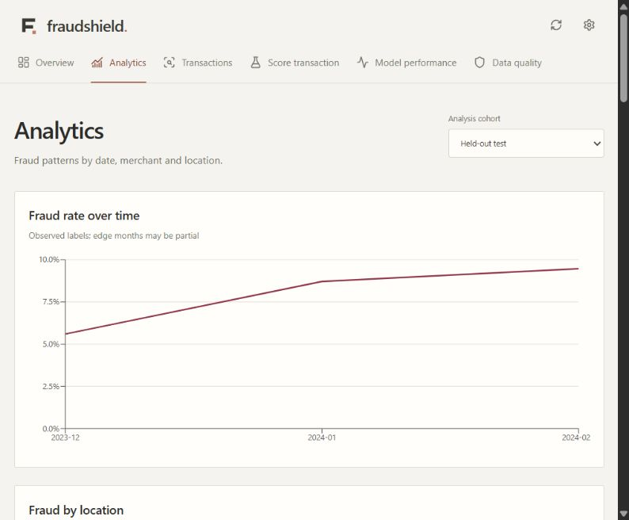
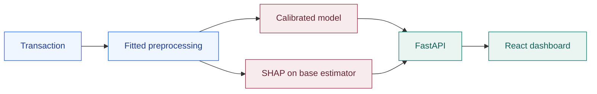

<div align="center">

# 🛡️ FraudShield AI

### Spot the risk. Understand the reason.

A fraud analysis workspace for exploring transactions, scoring risk, and explaining model predictions.

<p>
  
  
  
  
</p>

[Features](#-key-features) · [Getting started](#-installation--setup) · [Model results](#-model-results) · [Documentation](#-documentation)

</div>

---

## 📖 Introduction

FraudShield AI brings transaction analytics and machine learning into one dashboard. Users can explore fraud patterns, investigate individual records, and submit new transactions for risk scoring with feature-level explanations.

The project combines a **React + TypeScript frontend**, a **FastAPI backend**, and a **calibrated random forest model** trained on the included financial transaction dataset.



## 🎯 Problem & solution

A fraud score alone leaves questions unanswered: which transactions deserve attention, what patterns appear in the data, and why did the model flag a record?

FraudShield connects those tasks in one workspace. Start with an overview, narrow the transaction list, then inspect a prediction and the features that influenced it.

---

## ✨ Key features

| Feature | What you can do |
|---|---|
| **Fraud analytics** | Compare trends across dates, merchant categories, payment methods, and locations. |
| **Transaction investigation** | Search and filter records; inspect risk scores and known outcomes. |
| **Risk prediction** | Score individual transactions or submit JSON batches. |
| **Explainable predictions** | See SHAP contributions that raise or lower the base model's score. |
| **Performance analysis** | Review precision–recall curves, confusion matrices, and threshold tradeoffs. |
| **Data monitoring** | Inspect validation reports and distribution differences between training and test data. |

## 💻 Tech stack

| Layer | Tools |
|---|---|
| **Frontend** | React · TypeScript · Vite · Recharts |
| **Backend** | Python · FastAPI · Pydantic · Uvicorn |
| **Machine learning** | scikit-learn · SHAP |
| **Data analysis** | pandas · NumPy · SciPy · Matplotlib |
| **Testing** | pytest · HTTP smoke checks |

## ⚙️ How it works

1. **Prepare:** Validate transaction inputs and apply the fitted preprocessing pipeline.
2. **Predict:** Generate a fraud probability using the calibrated model.
3. **Explain:** Calculate SHAP contributions for the underlying estimator.
4. **Explore:** Display scores, explanations, and dataset analytics in the dashboard.



---

## 🚀 Installation & setup

**Prerequisites:** Python **3.12+**, Node.js **22+**, and Git. Commands below use Windows PowerShell.

### 1. Clone the repository

```powershell
git clone https://github.com/HarshBajania/FraudShield-AI.git
cd FraudShield-AI
```

### 2. Set up the backend and train the model

```powershell
python -m venv .venv
.\.venv\Scripts\Activate.ps1
python -m pip install -r requirements-lock.txt
python -m scripts.train
```

Training creates the model locally. It is excluded from Git, so this step is required on the first run. Reuse the saved model afterward.

### 3. Start the API

In the same terminal:

```powershell
python -m uvicorn api.main:app --host 127.0.0.1 --port 8000
```

### 4. Start the frontend

Open a second terminal in the project folder:

```powershell
cd frontend
npm ci
npm run dev -- --port 5174 --strictPort
```

| Service | Address |
|---|---|
| **Dashboard** | [http://localhost:5174](http://localhost:5174) |
| **Interactive API docs** | [http://localhost:8000/docs](http://localhost:8000/docs) |

Keep both terminals running. Optional configuration is listed in [.env.example](.env.example); export variables in your shell when needed.

## 📊 Model results

The selected **weighted random forest** uses probability calibration. Training, tuning, calibration, threshold selection, and testing use separate chronological windows.

| Metric | Held-out test result |
|---|---:|
| Test transactions | 745 |
| Average precision | 0.305 |
| ROC-AUC | 0.838 |
| Precision | 27.8% |
| Recall | 55.6% |

At the selected threshold, the model detected **35 of 63 fraud cases** and flagged **91 legitimate transactions**. See [full results](models/metadata.json) and [evaluation methodology](docs/methodology.md) for context.

> **Project scope:** FraudShield is a research project using static datasets. Source provenance, currency, and timezone are undocumented. Monitoring compares offline distributions; SHAP explains the base estimator before calibration.

---

## 📁 Project structure

```text
FraudShield-AI/
├── frontend/       # React dashboard
├── api/            # FastAPI routes and request schemas
├── src/            # Preprocessing, modeling, explanations, monitoring
├── scripts/        # Training, auditing, and smoke checks
├── configs/        # Training configuration
├── data/           # Datasets and data documentation
├── models/         # Model metadata and locally generated artifacts
├── notebooks/      # Analysis and experiments
├── tests/          # Automated tests
└── docs/           # Methodology, reports, and demo guide
```

## 🧪 Testing

With your Python environment active and the model trained:

```powershell
python -m pytest -q
```

With the API running, check the HTTP endpoints and prediction flow:

```powershell
python -m scripts.smoke
```

## 📚 Documentation

- [Modeling approach & evaluation](docs/methodology.md)
- [API endpoints & examples](docs/api.md)
- [Datasets & source limitations](data/README.md)
- [Validation report](docs/validation.md)
- [Demo walkthrough](docs/demo-guide.md)

## 🤝 Contributing

Create a feature branch, make your changes, run the relevant checks, and open a pull request with a description of the change.

---

<div align="center">

**FraudShield AI** · Developed by [Harsh Bajania](https://github.com/HarshBajania)

</div>
